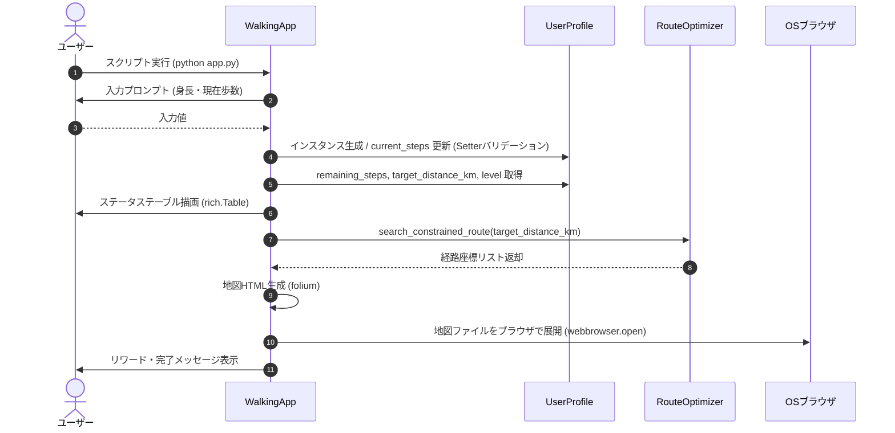

# 開発に必要な工程と順番  
## 工程名,主な目的,成果物（ドキュメント）  
- 1. 企画・要求定義,	なぜ作るのか、誰のどんな課題を解決するのかを明確にする,企画書、要求仕様書  
- 2. 要件定義,	課題解決のために**「システムが何を満たすべきか」**を決める,要件定義書   
- 3. 基本設計（外部設計）,	ユーザーから見えるインターフェースや全体の構造を決める,基本設計書（画面設計、ER図、API一覧）  
- 4. 詳細設計（内部設計）,	プログラマが**「コードに落とし込める」**レベルまで構造を詰める,詳細設計書（クラス図、関数仕様、シーケンス図）  
- 5. 実装（コーディング）,	設計書に従ってコードを書き、レビューを行う,ソースコード、環境設定スクリプト  
- 6. テスト（単体・結合・総合）,	設計書通りに動くか、バグや例外処理に耐えられるかを検証する,テスト仕様書、テスト結果報告書


# 任意距離充足型 ウォーキング支援シミュレータ (Walking Route Engine)

大学生の運動不足解消を目的とし、ゲーミフィケーション（歩数・レベル管理）とグラフ理論に基づく「任意距離充足経路探索」を組み合わせたウォーキング支援CLIアプリケーション。

---

## 1. 企画 (Project Planning)
* **背景**: オンライン授業や講義主体の生活により、大学生の日常的な身体活動量（歩数）の減少と運動不足が課題となっている。
* **目的**: 
  * 単調になりがちな徒歩移動を習慣化・ゲーム化し、自発的な運動を促進する。
  * 「あと〇〇歩足りない」という具体的な不足量に対し、手作業では算出が困難な「ちょうどその距離を達成できるウォーキング周回ルート」を即座に提示して行動のハードルを下げる。

---

## 2. 要求仕様 (Requirements Definition)
* **利用者の要求**:
  * 身長や現在の歩数を入力したら、個人に合わせた歩幅から目標達成に必要な不足距離を自動で算出し、あとどれくらい歩けばいいか一目で知りたい。
  * 達成意欲を持続させるためのレベルアップや次回目標などのゲーミフィケーション要素がほしい。
  * 不足歩数を埋めるための「具体的な散歩・ウォーキングコース」を地図上で確認したい。
* **検証・評価側の要求（講義演習の観点）**:
  * 外部サービスや高額なインフラに依存せず、ローカル環境単体で再現性を持って実行・評価できること。
  * 最短経路探索にとどまらず、距離制約を満たすアルゴリズム設計とオブジェクト指向設計（カプセル化・バリデーション）の妥当性が示されていること。

---

## 3. 要件定義 (System Requirements)

### 3.1 機能要件 (Functional Requirements)
1. **ユーザー・歩数・進捗管理機能**:
   * 身長（cm）に基づく個人歩幅の動的算出（`歩幅(m) = 身長(cm) × 0.45`）。
   * 本日の現在歩数の設定とバリデーション（整数型チェック、負数防止）。
   * 目標歩数（8,000歩）に対する不足歩数および目標距離（km）の自動計算。
2. **ゲーミフィケーション機能**:
   * 8,000歩（`LEVEL_STEP_UNIT`）ごとのプレイヤーレベル算出。
   * 次回レベルアップまでに必要な残り歩数の表示。
   * 本日の目標達成時に到達する想定レベル（`projected_level`）の算出。
3. **任意距離充足経路探索機能**:
   * 目標距離（km）を入力とし、指定座標（新潟大学五十嵐キャンパス周辺: 緯度 37.8694, 経度 138.9430）を起点とした周回経路座標列を計算。
4. **インタラクティブ地図生成・表示機能**:
   * 計算された経路をOpenStreetMap上にプロットしたHTMLファイルをFoliumで自動出力し、ブラウザで展開。

### 3.2 非機能要件 (Non-Functional Requirements)
* **実行環境**: Python 3.10+ (スタンドアロンCLI実行)。
* **外部依存性**: `rich`（CUI描画）、`folium`（地図可視化）。
* **操作性**: `rich` ライブラリを用いた視認性の高いテーブル表示とローディング演出。

---

## 4. 基本設計 (Basic Design / External Design)

### 4.1 システムアーキテクチャ
```Planetext
[ ユーザー (ターミナル入力) ]
│
▼
┌───────────────────────────────────────┐
│ WalkingApp (app.py)                   │
│  - コントローラー / CUI描画              │
│  - 起点座標: 新潟大学五十嵐キャンパス    │
└──────────┬─────────────────┬──────────┘
           │                 │
           ▼                 ▼
┌────────────────────┐  ┌───────────────────────────────────┐
│ UserProfile        │  │ RouteOptimizer                    │
│ (src/UserProfile)  │  │ (src/route.py)                    │
│  - 身長・歩数管理   │  │  - 距離制約経路計算               │
│  - 歩幅・距離算出   │  │                                  │
│  - レベル計算      │  │                                  │
└────────────────────┘  └─────────────────┬─────────────────┘
                                          │
                                          ▼
                                 [ Folium Map (HTML) ]
                                          │
                                          ▼
                                   [ ブラウザ表示 ]
```

### 4.2 画面（UI/UX）設計
* **Step 1**: タイトルパネル表示とユーザー情報入力プロンプト（身長、現在歩数等）。
* **Step 2**: ステータス解析結果テーブル（現在Lv、不足歩数、目標距離、次回Lvアップ条件等）の描画。
* **Step 3**: 経路探索ステータス（スピナーアニメーション）の実行。
* **Step 4**: 地図HTMLの自動生成およびブラウザ起動。

---

## 5. 詳細設計 (Detailed Design / Internal Design)

### 5.1 プロジェクト構造
```
info_system4/
├── app.py              # アプリケーションコントローラー (WalkingApp)
├── requirements.txt    # 依存ライブラリ一覧 (rich, folium)
├── README.md           # 本仕様・設計ドキュメント
└── src/
    ├── __init__.py     # パッケージ初期化 (UserProfile, RouteOptimizer のエクスポート)
    ├── UserProfile.py  # ユーザー情報・歩数・レベル管理モデル (UserProfile)
    └── route.py        # 経路探索サービスエンジン (RouteOptimizer)
```

### 5.2 モジュール・クラス設計

#### `UserProfile` (`src/UserProfile.py`)
ユーザーの歩行データおよびゲーミフィケーションステータスを管理するモデルクラス。

* **クラス定数**:
  * `LEVEL_STEP_UNIT: int = 8000`: レベルアップに必要な歩数単位。
* **属性 (Private)**:
  * `_height: int`: ユーザーの身長 (cm)。
  * `_current_steps: int`: 現在の歩数。
  * `_target_steps: int`: 目標歩数（初期値: 8000）。
* **コンストラクタ**:
  * `__init__(height: int, current_steps: int = 0)`:
    * `_height` を設定し、`target_steps` を 8000 で初期化。
    * `current_steps` セッターを通じてバリデーション付きで初期化。
* **プロパティ (Getter / Setter)**:
  * `get_height -> int` (Read-only): 身長を取得。
  * `current_steps -> int` (Getter): 現在の歩数を取得。
  * `current_steps = value: int` (Setter):
    * 現在の歩数を設定。
    * バリデーション:
      * 整数型以外は `TypeError("歩数は整数である必要があります。")` を送出。
      * 0未満の値は `ValueError("歩数に負の値を設定することはできません。")` を送出。
  * `target_steps -> int` (Read-only): 目標歩数を取得。
* **計算プロパティ (Read-only)**:
  * `remaining_steps -> int`:
    * 目標達成までに不足している歩数: `max(0, self._target_steps - self._current_steps)`
  * `target_distance_km -> float`:
    * 不足歩数から逆算した目標距離 (km)。
    * 歩幅算出: `_stride_m = self.get_height * 0.45`
    * 距離算出: `round((self.remaining_steps * _stride_m) / 1000.0, 2)`
  * `current_level -> int`:
    * 現在のプレイヤーレベル: `(self._current_steps // self.LEVEL_STEP_UNIT) + 1`
  * `next_level_steps -> int`:
    * 次レベル到達までに必要な歩数: `self.LEVEL_STEP_UNIT - (self._current_steps % self.LEVEL_STEP_UNIT)`
  * `projected_level -> int`:
    * 目標達成時の想定プレイヤーレベル: `((self._current_steps + self.remaining_steps) // self.LEVEL_STEP_UNIT) + 1`

#### `RouteOptimizer` (`src/route.py`)
グラフネットワーク上の制約付き経路探索を担当するサービスクラス。

* **属性 (Private)**:
  * `_base_lat: float`: 探索起点緯度。
  * `_base_lng: float`: 探索起点経度。
* **コンストラクタ**:
  * `__init__(base_lat: float, base_lng: float)`: 起点座標を保持。
* **メソッド**:
  * `search_constrained_route(target_distance_km: float) -> list[tuple[float, float]]`:
    * 目標距離を満たす周回経路を生成し、座標タプル `(lat, lng)` のリストとして返却（本番環境では OSMnx / NetworkX による探索処理を実装）。

#### `WalkingApp` (`app.py`)
ユーザー入出力および画面レンダリング、各コンポーネントの連携を制御するコントローラークラス。

* **クラス定数**:
  * `BASE_LAT: float = 37.8694`: 探索起点緯度（新潟大学五十嵐キャンパス周辺）。
  * `BASE_LNG: float = 138.9430`: 探索起点経度。
* **属性 (Private / Public)**:
  * `console: Console`: `rich.console.Console` インスタンス。
  * `optimizer: RouteOptimizer`: 拠点座標で初期化された経路探索インスタンス。
  * `_height: int`: ユーザー身長。
  * `_current_steps: int`: 現在歩数。
  * `_profile: UserProfile`: ユーザー情報・進捗管理インスタンス。
* **プロパティ (Getter / Setter)**:
  * `height: int` (Getter / Setter): 身長の取得および設定（正の整数バリデーション付き）。
  * `current_steps: int` (Getter / Setter): 現在歩数の取得および設定（0以上の整数バリデーション付き）。
  * `profile: UserProfile` (Getter / Setter): プロファイルの取得および設定。
* **メソッド**:
  * `__init__()`: コンソール、RouteOptimizer、内部属性を初期化。
  * `run() -> None`: アプリケーション全体の実行制御（対話的入力、テーブル描画）。

### 5.3 処理フロー (シーケンス)
