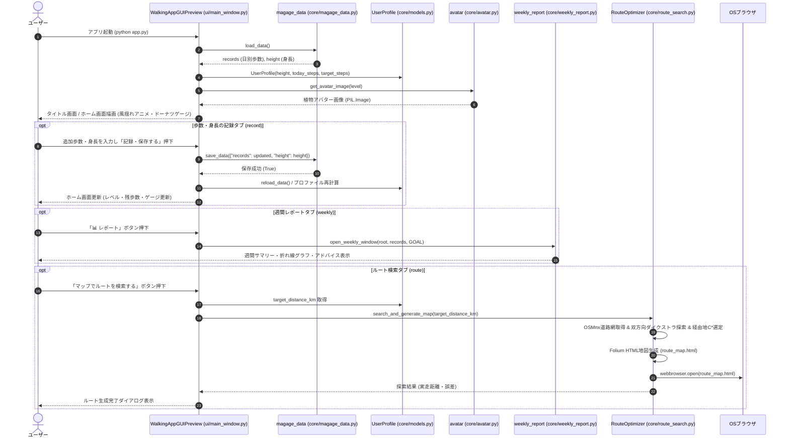

# 開発に必要な工程と順番  
## 工程名,主な目的,成果物（ドキュメント）  
- 1. 企画・要求定義,	なぜ作るのか、誰のどんな課題を解決するのかを明確にする,企画書、要求仕様書  
- 2. 要件定義,	課題解決のために**「システムが何を満たすべきか」**を決める,要件定義書   
- 3. 基本設計（外部設計）,	ユーザーから見えるインターフェースや全体の構造を決める,基本設計書（画面設計、ER図、API一覧）  
- 4. 詳細設計（内部設計）,	プログラマが**「コードに落とし込める」**レベルまで構造を詰める,詳細設計書（クラス図、関数仕様、シーケンス図）  
- 5. 実装（コーディング）,	設計書に従ってコードを書き、レビューを行う,ソースコード、環境設定スクリプト  
- 6. テスト（単体・結合・総合）,	設計書通りに動くか、バグや例外処理に耐えられるかを検証する,テスト仕様書、テスト結果報告書


# 任意距離充足型 ウォーキング支援＆アバター育成システム (Walking & Avatar Growth)

大学生の運動不足解消を目的とし、ゲーミフィケーション（歩数に応じた10段階の植物アバター育成・多重ラップドーナツゲージ・週間レポート）とグラフ理論に基づく「任意距離充足経路探索」を組み合わせたウォーキング支援デスクトップGUIアプリケーション。

---

## 1. 企画 (Project Planning)
* **背景**: オンライン授業や講義主体の生活により、大学生の日常的な身体活動量（歩数）の減少と運動不足が課題となっている。
* **目的**: 
  * 単調になりがちな徒歩移動を視覚的に楽しめるアバター育成と週間グラフで習慣化・ゲーム化し、自発的な運動を促進する。
  * 「あと〇〇歩足りない」という具体的な不足量に対し、手作業では算出が困難な「ちょうどその距離を達成できるウォーキングコース」を道路網グラフから即座に算出・地図表示して行動のハードルを下げる。

---

## 2. 要求仕様 (Requirements Definition)
* **利用者の要求**:
  * 身長や歩数をGUIから直感的に入力・保存でき、個人に合わせた歩幅から目標達成に必要な不足距離を自動で算出し、あとどれくらい歩けばいいか一目で知りたい。
  * 達成意欲を持続させるため、歩数に応じて植物が「種 → 発芽 → 双葉 → 蕾 → 満開の花」へと成長するアバター演出や、1週間の歩数推移を振り返るレポート機能がほしい。
  * 不足歩数を埋めるための「具体的な散歩・ウォーキングコース」を地図上で確認したい。
* **検証・評価側の要求（講義演習の観点）**:
  * 外部の有料サービスや大規模なDBインフラに依存せず、ローカル環境（JSON永続化＋OpenStreetMapデータ）単体で再現性を持って実行・評価できること。
  * 単なる最短経路探索にとどまらず、上限枝刈り付きダイクストラ法と幾何楕円帯域フィルタリングを組み合わせた距離制約充足アルゴリズム、およびUI層（`ui/`）とドメイン・サービス層（`core/`）を分離したオブジェクト指向設計（カプセル化・バリデーション・アトミック保存）の妥当性が示されていること。

---

## 3. 要件定義 (System Requirements)

### 3.1 機能要件 (Functional Requirements)
1. **ユーザー・歩数・進捗管理機能 (`core/models.py`, `core/magage_data.py`)**:
   * 身長（cm）に基づく個人歩幅の動的算出（`歩幅(m) = (身長(cm) × 0.45) / 100`）。
   * 本日の歩数の加算記録・身長設定と入力バリデーション（整数・正数チェック）。
   * 目標歩数（デフォルト: 8,000歩）に対する不足歩数・超過歩数および目標距離（km / m）の自動計算。
   * 一時ファイル置換（`.tmp` → 本ファイル）によるJSONデータのアトミック保存とデータ同期。
2. **ゲーミフィケーション＆アバター育成機能 (`core/avatar.py`, `ui/main_window.py`)**:
   * 8,000歩（`LEVEL_STEP_UNIT`）ごとのプレイヤーレベル算出（Lv.1〜最大Lv.10）。
   * 次回レベルアップまでに必要な残り歩数、および目標達成時の想定レベル（`projected_level`）の算出。
   * レベル（Lv.1〜Lv.10）に応じた植物アバター画像の自動生成（Pillow描画）と、サイン波による風揺れアニメーション表示。
   * 目標達成周回数（ラップ数）に応じて配色が変化する多重ラップ対応ドーナツゲージの描画。
3. **週間歩数レポート機能 (`core/weekly_report.py`)**:
   * 今週（月曜日〜日曜日）の日別歩数データの集計（今週の合計歩数、1日平均歩数、目標達成日数）。
   * Tkinter Canvasを用いた折れ線グラフ描画（実績実線・翌日予測破線・目標8,000歩ライン・達成ドット色分け）と達成度に応じたアドバイスメッセージ表示。
4. **任意距離充足経路探索＆インタラクティブ地図生成機能 (`core/route_search.py`)**:
   * 目標距離（km / m）を入力とし、新潟大学五十嵐キャンパス周辺を起点（A）・終点（B）とした歩行者道路網グラフをOSMnxで取得。
   * 始点Aからの正方向および終点Bからの逆方向の「上限距離枝刈り付きダイクストラ法」を実行し、2次元外積による左右半平面判定と楕円帯域フィルタリングから、`dist(A → C*) + dist(C* → B)` が目標距離に最も近い最適経由点 `C*` を選出。
   * 算出された経路を国土地理院タイル上にプロットしたHTMLマップ（Folium）を自動生成し、OS標準ブラウザで展開。

### 3.2 非機能要件 (Non-Functional Requirements)
* **実行環境**: Python 3.10+（Tkinter標準GUI搭載環境）。
* **外部依存ライブラリ**: `folium`（地図可視化）、`networkx`（グラフ構造処理）、`osmnx`（OpenStreetMap道路網取得）、`scikit-learn`（未投影グラフ上の最近傍ノード探索）、`Pillow`（アバター画像生成・回転アニメーション）。
* **データ整合性**: 一時ファイル経由のアトミック書き込みにより、保存途中のクラッシュによるJSON破損を防止。

---

## 4. 基本設計 (Basic Design / External Design)

### 4.1 システムアーキテクチャ
```text
[ ユーザー (マウス・キーボード操作) ]
 │
 ▼
┌─────────────────────────────────────────────────────────────────────────┐
│ UI Layer: WalkingAppGUIPreview (ui/main_window.py) / Entry (app.py)     │
│  - タイトル画面 / ホーム画面 / 歩数記録画面 / ルート検索画面            │
│  - 風揺れアバターアニメーション / 多重ラップドーナツゲージ描画          │
└───────┬───────────────┬───────────────────┬─────────────────────┬───────┘
        │               │                   │                     │
        ▼               ▼                   ▼                     ▼
┌──────────────┐ ┌──────────────┐ ┌────────────────────┐ ┌────────────────────┐
│ UserProfile  │ │ magage_data  │ │ avatar             │ │ weekly_report      │
│ (models.py)  │ │ (JSON永続化) │ │ (avatar.py)        │ │ (weekly_report.py) │
│ - 歩幅/距離  │ │ - data.json  │ │ - Lv.1〜10植物描画 │ │ - 週間統計集計     │
│ - Lv/残歩数  │ │ - アトミック │ │ - PNG自動生成      │ │ - Canvas折れ線描画 │
└──────────────┘ └──────────────┘ └────────────────────┘ └────────────────────┘
        │
        │ (target_distance_km)
        ▼
┌─────────────────────────────────────────────────────────────────────────┐
│ RouteOptimizer (core/route_search.py)                                   │
│  - OSMnx 歩行者道路網取得 (新潟大学五十嵐キャンパス周辺)                │
│  - 双方向ダイクストラ法 (上限枝刈り) + 幾何半楕円帯域フィルタリング     │
│  - 最適経由地 C* 選定 & 経路復元 (A → C* → B)                           │
└───────────────────────────────────┬─────────────────────────────────────┘
                                    │
                                    ▼
                         [ Folium Map (route_map.html) ]
                                    │
                                    ▼
                            [ OS標準ブラウザ表示 ]
```

### 4.2 画面（UI/UX）設計
* **画面1: タイトル画面 (`show_title_screen`)**
  * スカイブルーを基調としたウェルカム画面。現在レベルのアバターが風に揺れるアニメーションと点滅する「TOUCH TO START」ラベルを表示し、画面クリックでメイン画面へ遷移。
* **画面2: ホーム画面 (`render_home_tab`)**
  * 上部カードに現在レベル（Lv.1〜Lv.10）の植物アバターをアニメーション表示。
  * 下部ステータスカードに現在レベル、本日の歩数、目標歩数、不足距離（km）、次レベルまでの歩数、および多重ラップ対応ドーナツゲージを表示。
* **画面3: 歩数・身長記録画面 (`render_record_tab`)**
  * 本日追加する歩数（整数）と身長（cm）の入力フォームを提供。「記録・保存する」ボタン押下でバリデーション後にJSONへアトミック保存し、ホーム画面へ即時反映。
* **画面4: 周回ルート検索画面 (`render_route_tab`)**
  * 目標達成に必要な残り距離（km）を表示。
  * **開始地点（始点A）の緯度・経度**、および **終了地点（終点B）の緯度・経度** を入力する4つのテキストボックスを配置。「開始する（マップでルート検索）」ボタン押下を契機に入力値を変数および `RouteOptimizer` の座標へ代入・上書きし、HTML地図を生成してブラウザで自動表示。
* **画面5: 週間レポート画面 (`open_weekly_window` / ポップアップウィンドウ)**
  * ナビゲーションバーの「📊 レポート」から起動。今週（月〜日）の合計歩数・1日平均・目標達成日数のサマリーカード、日別歩数推移の折れ線グラフ、および達成日数に応じたアドバイスメッセージを表示。

---

## 5. 詳細設計 (Detailed Design / Internal Design)

### 5.1 プロジェクト構造
```text
step_counter/
├── app.py                  # アプリケーション起動エントリーポイント
├── requirements.txt        # 外部依存ライブラリ一覧 (folium, networkx, osmnx, Pillow, scikit-learn)
├── README.md               # 本仕様・設計ドキュメント
├── public/                 # 自動生成されるアバター画像キャッシュ (avatar_lv1.png 〜 avatar_lv10.png)
├── ui/
│   ├── __init__.py         # UIパッケージ初期化 (WalkingAppGUIPreview のエクスポート)
│   └── main_window.py      # メインGUIコントローラー・画面描画クラス (WalkingAppGUIPreview)
└── core/
    ├── __init__.py         # コアパッケージ初期化・各モジュール公開インターフェース
    ├── models.py           # ユーザー情報・歩数・レベル計算モデル (UserProfile)
    ├── magage_data.py      # JSON永続化・アトミック保存モジュール (load_data, save_data)
    ├── avatar.py           # Lv.1〜Lv.10 植物成長アバター画像生成モジュール
    ├── route_search.py     # 距離制約充足経路探索・Folium地図生成エンジン (RouteOptimizer)
    ├── weekly_report.py    # 週間歩数レポートToplevelウィンドウ・折れ線グラフ描画モジュール
    └── data.json           # 統合データ永続化ファイル (日別歩数 records, 身長 height)
```

### 5.2 モジュール・クラス設計

#### 1. `UserProfile` (`core/models.py`)
ユーザーの歩行データおよびゲーミフィケーションステータスを管理するドメインモデルクラス。

* **クラス定数**:
  * `DEFAULT_HEIGHT: float = 170.0`: デフォルト身長 (cm)。
  * `DEFAULT_TARGET_STEPS: int = 8000`: デフォルト目標歩数。
  * `LEVEL_STEP_UNIT: int = 8000`: 1レベルアップに必要な歩数単位。
  * `MAX_LEVEL: int = 10`: アバターの最大レベル。
  * `STRIDE_FACTOR: float = 0.45`: 身長に対する歩幅係数。
* **コンストラクタ**:
  * `__init__(height: float = 170.0, current_steps: int = 0, target_steps: int = 8000)`:
    * 各プロパティのSetterを通して型・値域のバリデーションを行い初期化。
* **プロパティ (Getter / Setter)**:
  * `height -> float`: 身長 (cm) の取得・設定（0以下の数値および非数値は例外送出）。
  * `current_steps -> int`: 現在の歩数の取得・設定（負の整数および非整数は例外送出）。
  * `target_steps -> int`: 目標歩数の取得・設定（0以下の整数および非整数は例外送出）。
* **計算プロパティ (Read-only)**:
  * `stride_m -> float`: 推定歩幅 `(height * 0.45) / 100.0` (m)。
  * `remaining_steps -> int`: 目標達成までの不足歩数 `max(0, target_steps - current_steps)`。
  * `over_steps -> int`: 目標歩数を超えた歩数 `max(0, current_steps - target_steps)`。
  * `target_distance_km -> float`: 不足歩数から逆算した目標歩行距離 `round((remaining_steps * stride_m) / 1000.0, 2)` (km)。
  * `target_distance_m -> float`: 不足歩数から逆算した目標歩行距離 (m)。
  * `current_level -> int`: 現在のアバターレベル `min(10, (current_steps // 8000) + 1)`。
  * `next_level_steps -> int`: 次レベル到達までに必要な残り歩数（Lv.10到達時は `0`）。
  * `projected_level -> int`: 本日の目標達成時に到達する想定レベル。

#### 2. データ永続化モジュール (`core/magage_data.py`)
日別歩数記録（`YYYY-MM-DD` キー）と身長設定を `core/data.json` に一括して安全に読み書きするモジュール。

* **関数**:
  * `load_data() -> dict[str, Any]`:
    * `core/data.json` から歩数辞書と身長を読み込み、`{"records": dict[str, int], "height": float}` 形式で返却。ファイル不在・破損時はデフォルト値を返却。
  * `save_data(data: dict[str, Any]) -> bool`:
    * 一時ファイル（`data.tmp`）に書き出した後 `Path.replace()` で `core/data.json` をアトミックに置換保存。

#### 3. アバター画像生成モジュール (`core/avatar.py`)
Pillow (`PIL.ImageDraw`) を用いて、種（Lv.1）から発芽・双葉・本葉・蕾を経て満開の花（Lv.10）に至る10段階のアバター画像をプロシージャル生成するモジュール。

* **関数**:
  * `create_avatar_image(level: int, output_size: tuple[int, int] = (200, 200)) -> Image.Image`:
    * 指定レベル（1〜10）の植物イラストをRGBAキャンバスに描画し、アンチエイリアス（LANCZOS）リサイズして返却。
  * `generate_10_growth_stages(output_dir: Optional[Path] = None) -> dict[int, Path]`:
    * Lv.1〜Lv.10のPNG画像（`avatar_lv1.png`〜`avatar_lv10.png` および `avatar.png`）を `public/` ディレクトリに一括生成。
  * `get_avatar_image(level: int = 1, size: tuple[int, int] = (170, 170), output_dir: Optional[Path] = None) -> Image.Image`:
    * キャッシュ済みPNGがあれば読み込み、存在しない場合は自動生成した上で指定サイズの `Image.Image` を返却。

#### 4. `RouteOptimizer` (`core/route_search.py`)
OpenStreetMapの歩行者道路網グラフ上で目標距離を満たす経路を探索し、Folium地図を生成するサービスクラス。

* **コンストラクタ**:
  * `__init__(base_lat: float = 37.8694, base_lng: float = 138.9430, start_coords: tuple[float, float] = DEFAULT_START_COORDS, end_coords: tuple[float, float] = DEFAULT_END_COORDS)`:
    * 新潟大学五十嵐キャンパス周辺の基準座標および始点A・終点B座標を保持。
* **主要メソッド**:
  * `haversine_distance(lat1, lon1, lat2, lon2) -> float`: 2点間の大圏直線距離（m）を算出。
  * `cross_product_2d(a, b, c) -> float`: ベクトルABに対する点Cの2次元外積（左右半平面判定用）を算出。
  * `dijkstra_with_cutoff(G, start_node, max_cost, reverse=False) -> tuple[dict, dict]`: 上限距離 `max_cost` で枝刈りを行う正順・逆順ダイクストラ法。
  * `generate_target_route_map(start_coords, end_coords, target_distance, side="left", output_html="route_map.html") -> dict`:
    * 目標距離（m）が2点間直線距離に対して短い場合は終点座標を自動補間調整。
    * 楕円帯域フィルタリングにより実走距離和 `dist_A[node] + dist_B[node]` が目標距離に最も近い経由点 `C*` を選出し、経路 `A → C* → B` を復元してFolium HTMLマップを保存。
  * `search_and_generate_map(target_distance_km: float, side: str = "left", output_html: str = DEFAULT_OUTPUT_HTML, open_browser: bool = True) -> dict`:
    * UIから受け取った目標距離（km）をメートル換算して地図を生成し、`webbrowser.open()` でブラウザ表示。

#### 5. 週間レポートモジュール (`core/weekly_report.py`)
* **関数**:
  * `open_weekly_window(parent: tk.Misc, records: Optional[dict[str, int]], goal: int = 8000) -> tk.Toplevel`:
    * 今週（月曜〜日曜）の歩数データを集計し、サマリーカード・折れ線グラフ（Canvas）・アドバイスメッセージを備えたToplevelウィンドウを生成・表示。

#### 6. `WalkingAppGUIPreview` (`ui/main_window.py`)
画面遷移・ユーザー入力・アニメーション・各コアモジュール呼び出しを統括するGUIコントローラークラス。

* **主要メソッド**:
  * `reload_data() -> None`: `load_data()` から最新データを取得し、`UserProfile` インスタンスを再構築。
  * `show_title_screen() -> None` / `show_main_app() -> None`: タイトル画面とメイン画面（ヘッダー・コンテンツ領域・下部ナビゲーションバー）の切り替え。
  * `switch_tab(tab_name: str) -> None`: `"home"`, `"record"`, `"route"`, `"weekly"` の各画面・ウィンドウへのルーティング。
  * `load_avatar_image(...)` / `animate_sway()`: `core.avatar.get_avatar_image()` で取得したアバター画像の表示とサイン波回転アニメーション制御。
  * `on_update_steps() -> None`: 歩数・身長入力の検証と `save_data()` による保存処理。
  * `on_search_route() -> None`: `RouteOptimizer.search_and_generate_map()` の実行と結果ダイアログ表示。

---

### 5.3 処理フロー (シーケンス)


---

## 6. セットアップ・実行方法 (Setup & Usage)

### 6.1 Windows バッチファイルからのワンクリック起動（推奨）
Windows環境では、[run.bat](file:///home/zorta/progmiraming/python/info_system/step_counter/run.bat) を実行することで、仮想環境（`.venv`）の作成・有効化、初回のみの `requirements.txt` インストール（2回目以降は自動スキップ）、および `app.py` の起動が自動で行われます。

```bat
run.bat
```

### 6.2 手動でのセットアップ・起動
```bash
pip install -r requirements.txt
python app.py
```


---

## 6. セットアップ・実行方法 (Setup & Usage)

### 6.1 Windows バッチファイルからのワンクリック起動（推奨）
Windows環境では、[run.bat](file:///home/zorta/progmiraming/python/info_system/step_counter/run.bat) を実行することで、仮想環境（`.venv`）の作成・有効化、初回のみの `requirements.txt` インストール（2回目以降は自動スキップ）、および `app.py` の起動が自動で行われます。

```bat
run.bat
```

### 6.2 手動でのセットアップ・起動
```bash
pip install -r requirements.txt
python app.py
```